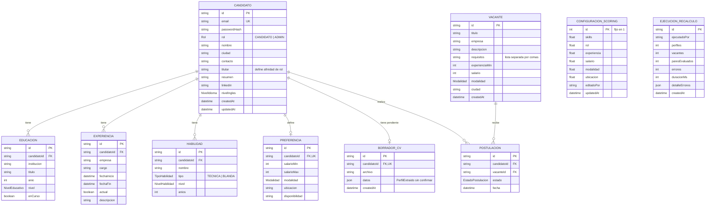
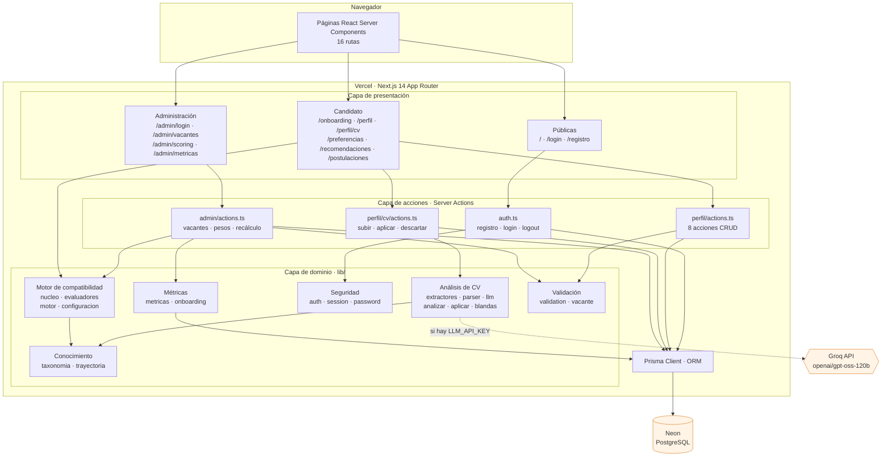
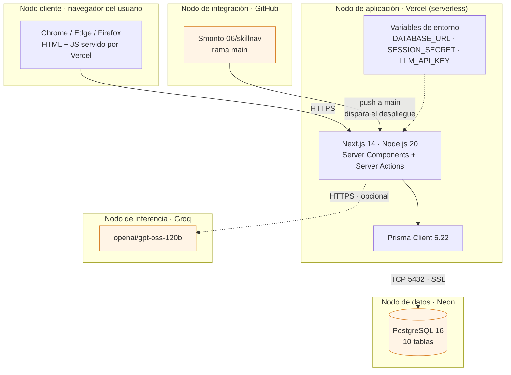
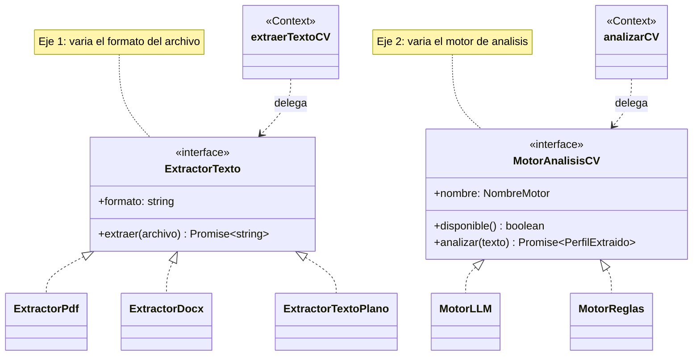
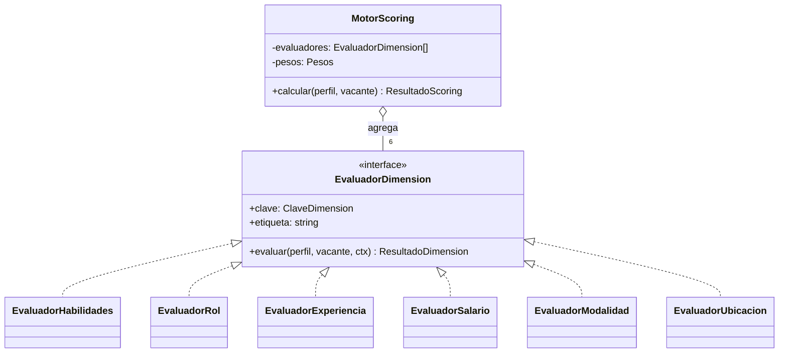
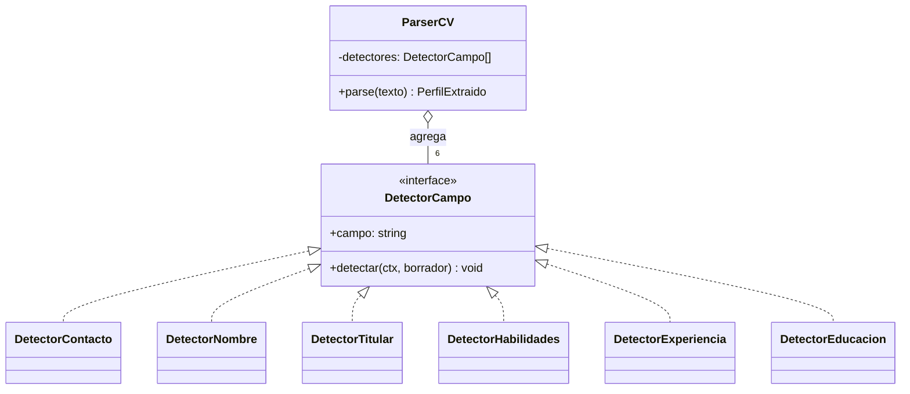

# Diagramas de Arquitectura y Diseño — Entrega 3

## 1. Diagrama de Clases General

```mermaid
classDiagram
    direction TB

    %% ---------- Analisis de hoja de vida (HU-21 a HU-23) ----------
    class ExtractorTexto {
        <<interface>>
        +formato: string
        +extraer(archivo: ArchivoCV) Promise~string~
    }
    class ExtractorPdf {
        +formato = "PDF"
        +extraer(archivo) Promise~string~
    }
    class ExtractorDocx {
        +formato = "DOCX"
        +extraer(archivo) Promise~string~
    }
    class ExtractorTextoPlano {
        +formato = "TXT"
        +extraer(archivo) Promise~string~
    }
    class ExtractorFactory {
        -POR_MIME: Record
        -POR_EXTENSION: Record
        +crear(archivo) ExtractorTexto
        +extensionDe(nombre) string
        +formatosSoportados() string[]
    }
    ExtractorTexto <|.. ExtractorPdf
    ExtractorTexto <|.. ExtractorDocx
    ExtractorTexto <|.. ExtractorTextoPlano
    ExtractorFactory ..> ExtractorTexto : crea

    class MotorAnalisisCV {
        <<interface>>
        +nombre: NombreMotor
        +disponible() boolean
        +analizar(texto: string) Promise~PerfilExtraido~
    }
    class MotorLLM {
        -cfg: ConfigLLM
        +nombre = "llm"
        +disponible() boolean
        +analizar(texto) Promise~PerfilExtraido~
    }
    class MotorReglas {
        -parser: ParserCV
        +nombre = "reglas"
        +disponible() boolean
        +analizar(texto) Promise~PerfilExtraido~
    }
    MotorAnalisisCV <|.. MotorLLM
    MotorAnalisisCV <|.. MotorReglas

    class DetectorCampo {
        <<interface>>
        +campo: string
        +detectar(ctx: ContextoCV, borrador: PerfilExtraido) void
    }
    class DetectorContacto
    class DetectorNombre
    class DetectorTitular
    class DetectorHabilidades
    class DetectorExperiencia
    class DetectorEducacion
    DetectorCampo <|.. DetectorContacto
    DetectorCampo <|.. DetectorNombre
    DetectorCampo <|.. DetectorTitular
    DetectorCampo <|.. DetectorHabilidades
    DetectorCampo <|.. DetectorExperiencia
    DetectorCampo <|.. DetectorEducacion

    class ParserCV {
        -detectores: DetectorCampo[]
        +parse(texto: string) PerfilExtraido
    }
    class ContextoCV {
        +texto: string
        +lineas: string[]
        +secciones: Map
        +layoutMezclado: boolean
        +encabezadoDe(linea) string
        +layoutEsConfiable(lineas, secciones) boolean
        +fuente(nombre) string[]
    }
    ParserCV o-- "1..*" DetectorCampo : compone
    ParserCV ..> ContextoCV : usa
    MotorReglas --> ParserCV

    %% ---------- Motor de compatibilidad (HU-24, HU-27) ----------
    class EvaluadorDimension {
        <<interface>>
        +clave: ClaveDimension
        +etiqueta: string
        +evaluar(perfil, vacante, ctx) ResultadoDimension
    }
    class EvaluadorHabilidades {
        +clave = "skills"
    }
    class EvaluadorRol {
        +clave = "rol"
        +areasDe(vacante) Area[]
    }
    class EvaluadorExperiencia {
        +clave = "experiencia"
    }
    class EvaluadorSalario {
        +clave = "salario"
    }
    class EvaluadorModalidad {
        +clave = "modalidad"
    }
    class EvaluadorUbicacion {
        +clave = "ubicacion"
    }
    EvaluadorDimension <|.. EvaluadorHabilidades
    EvaluadorDimension <|.. EvaluadorRol
    EvaluadorDimension <|.. EvaluadorExperiencia
    EvaluadorDimension <|.. EvaluadorSalario
    EvaluadorDimension <|.. EvaluadorModalidad
    EvaluadorDimension <|.. EvaluadorUbicacion

    class MotorScoring {
        -evaluadores: EvaluadorDimension[]
        -pesos: Pesos
        +calcular(perfil, vacante, ahora) ResultadoScoring
        +dimensiones() Array
    }
    MotorScoring o-- "6" EvaluadorDimension : compone

    class PerfilExtraido {
        +nombre: CampoDetectado
        +email: CampoDetectado
        +telefono: CampoDetectado
        +habilidades: CampoDetectado
        +experiencias: CampoDetectado
        +educacion: CampoDetectado
        +layoutMezclado: boolean
        +textoOriginal: string
    }
    class ResultadoScoring {
        +score: number
        +desglose: Desglose
        +requisitos: EvaluacionRequisito[]
        +motivoRol: string
        +motivoExperiencia: string
    }
    MotorAnalisisCV ..> PerfilExtraido : produce
    MotorScoring ..> ResultadoScoring : produce
```

---

## 2. Diagrama Entidad-Relación (ER)

---

## 3. Diagrama de Componentes / Arquitectura

---

## 4. Diagrama de Despliegue

---

## 5. Patrón Strategy — Análisis de CV

---

## 6A. Patrón Composite — Motor de Scoring

---

## 6B. Patrón Composite — Parser de CV

## Qué va en esta carpeta

| Archivo | Qué es |
|---|---|
| `1-clases.png` | Diagrama de clases de implementación |
| `2-entidad-relacion.png` | Modelo entidad-relación (las 10 tablas) |
| `3-componentes.png` | Diagrama de componentes |
| `4-despliegue.png` | Diagrama de despliegue |
| `5-patron-strategy.png` | Recorte del patrón Strategy |
| `6a-composite-scoring.png` | Recorte del patrón Composite — motor de scoring |
| `6b-composite-parser.png` | Recorte del patrón Composite — lector de CV |
| `diagramas-entrega3.md` | Código fuente de los diagramas, en Mermaid |
| `fuentes-recortes.mmd` | Código fuente de los recortes de patrones |
| `para-drawio/` | Los siete diagramas listos para abrir en draw.io |

Los cuatro primeros son los que exige la plantilla de la entrega. Los tres
recortes ilustran las fichas de patrones de la Sección 6 del informe.

El código fuente se versiona junto a las imágenes para poder regenerarlas si
hay que corregir algo, en lugar de depender de un editor externo.

## Cómo subirlos

Entrar a esta carpeta en GitHub, **Add file → Upload files**, arrastrar y
confirmar con **Commit changes**. Al estar ya dentro de la carpeta no hace
falta escribir ninguna ruta.
